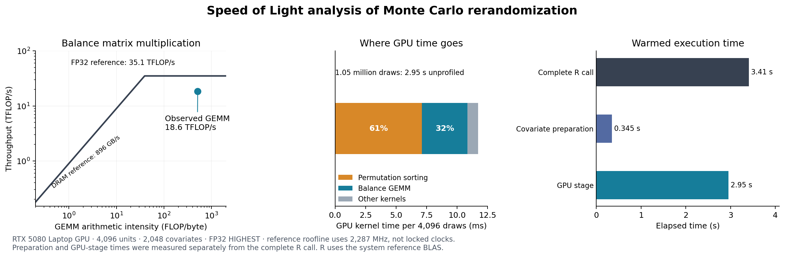

# Speed of Light Analysis

The complete warmed Monte Carlo R call takes **3.410 seconds** in the selected high-dimensional workload. Production covariate preparation takes **0.345 seconds**, and repeated API calls reproduce their assignments and balance scores exactly.

The GPU pipeline takes **2.951 seconds**. Its balance matrix multiplication sustains **18.55 TFLOP/s**, or **52.8% of an analytical FP32 reference at NVIDIA's listed upper laptop boost clock**. This is a scoped GEMM roofline comparison, not a counter-measured Nsight Compute SOL percentage or an end-to-end utilization estimate. Permutation sorting remains the largest GPU cost.



[PDF figure](speed_of_light.pdf) · [SVG figure](speed_of_light.svg) · [Performance and correctness results](results/metrics.json) · [Reproduction instructions](REPRODUCE.md)

## Source, workload, and environment

The measurements, collected October 22, 2026, use production source `171777d1838e7c2a16bca89c6cec6081f3bf23bf`, installed into a private R library on `cjerzak-rog`. All 56 package files and the executed measurement harness were verified against their remote copies. [Source manifest](results/manifest.json).

The workload is `generate_randomizations()` with Monte Carlo sampling, the default threshold, `approximate_inv = TRUE`, and R output: **4,096 units, 2,048 treated, 2,048 independent normal covariates, 1,048,576 candidate draws, batch size 4,096, and acceptance probability 0.001**, returning 1,049 assignments. R data seed is 20261022; JAX seed is 77. This is deliberately favorable to dense GPU arithmetic. Batch size is explicit; the package's automatic size here is 1,024.

The host has an Intel Core Ultra 9 285H and NVIDIA GeForce RTX 5080 **Laptop** GPU (60 SMs, 7,680 CUDA cores, 16 GB GDDR7, 48 MiB L2). It uses driver 615.71.10, CUDA toolkit 13.4, JAX/JAXlib 0.11.1, NumPy 2.5.3, and R 4.5.2. R uses the **system reference BLAS**, `/usr/lib/x86_64-linux-gnu/blas/libblas.so.3.12.1`; the host timings are specific to that configuration. Device arrays use float32 and `Precision.HIGHEST`. Clocks and power policy were not modified. [Runtime metadata](results/api/metadata.json), [hardware and tool versions](results/hardware_and_software.txt).

## Host preparation

For default diagonal scoring, [`.balance_design()`](../../fastrerandomize/R/FRR_HelperFxns.R) centers covariates in float64, computes population variances and reciprocal variances, and scales the centered matrix. It skips full covariance construction, eigendecomposition, and full inversion, requiring work proportional to the covariate matrix size.

Monte Carlo and exact generation request this diagonal-only preparation for the recognized default diagonal statistic. Full covariance scoring computes the complete design. Every custom threshold receives both inverse forms, even with `approximate_inv = TRUE`; the internal helper also defaults to the complete design.

## Measured performance

| Measured scope | Time |
|---|---:|
| Complete warmed R API | 3.410 s |
| Production covariate preparation | 0.345 s |
| Fused GPU generation, validation, scoring, and ranking | 2.951 s |
| Balance GEMM within the GPU pipeline | 3.704 ms |
| First API call after backend/input setup | 11.956 s |

The complete-call median uses seven warmed calls, with a range of **3.385–3.569 s**. The API timer includes input validation, preparation, transfers, scoring, ranking, accepted-assignment regeneration/checks, and R materialization. Backend initialization and input generation precede it. The separately reported first call includes additional compilation; it is not a fresh-process startup measurement. [API samples](results/api/n4096_p2048_b4096_d1048576.json).

The preparation median uses five unprofiled calls, with a range of **0.317–0.370 s**. Unit tests fail explicitly if covariance construction or decomposition is attempted on the diagonal-only path. [Preparation samples and profile](results/hostprep/n4096_p2048_b4096_d1048576.json).

Fused GPU timing uses 15 synchronized calls after three warmups. The 10th–90th percentile is **2.930–3.090 s**. Laptop clocks are unlocked, and telemetry records clock, temperature, and power variation. Stage timings are measured separately and are not an additive decomposition of one API call.

Resident `WhitenedT2Jit` takes **4.532 ms** per batch; generating, validating, and scoring a batch takes **11.744 ms**. Each uses 100 synchronized calls, following 300 and 150 warmups respectively. All device timers block on completion, with compilation outside the warmed timings. GPU jobs run sequentially. [JAX benchmarking guidance](https://docs.jax.dev/en/latest/benchmarking.html).

## GPU roofline and remaining headroom

For the balance product `W[B,n] @ Xw[n,p]`, counting a fused multiply-add as two FLOPs:

```text
F = 2 B n p                      = 68,719,476,736 FLOP per batch
D = 4 (B n + n p + B p)         = 134,217,728 bytes of minimum GEMM traffic
I = F / D                       = 512 FLOP/byte
P_ref = 7,680 × 2 × 2.287 GHz   = 35.12832 TFLOP/s
BW_ref                          = 896.064 GB/s
t_ref = max(F/P_ref, D/BW_ref)  = max(1.956 ms, 0.150 ms) = 1.956 ms
```

The compute reference uses NVIDIA's listed upper laptop boost clock of 2,287 MHz; it is not a measured sustainable clock or a locked operating point. The bandwidth reference agrees with NVIDIA's rounded 896 GB/s specification. The minimum-traffic model makes this GEMM compute-bound. Reduced-precision Tensor Core TOPS are not the appropriate reference for the production SIMT FP32 SGEMM. [NVIDIA laptop specifications](https://www.nvidia.com/en-us/geforce/laptops/50-series/).

During the full-pipeline capture, 92 telemetry samples with at least 90% reported GPU utilization recorded SM clocks of **1.432–1.912 GHz** (median 1.710 GHz). These 100 ms samples cannot establish the clock of each 3–4 ms GEMM. The driver also advertises a maximum SM clock of 3,090 MHz; that capability value is not the specification-based reference used here. Neither it nor sampled clocks should silently replace the stated denominator. [Clock samples](results/profile_all/telemetry.csv), [derived metrics](results/metrics.json).

Across **768 GEMM launches in three full-pipeline captures**, the median is **3.704 ms**, yielding **18.55 TFLOP/s**, **52.8%** of this reference, or **1.89×** its idealized compute time. Nsight Systems measures kernel durations; it does not establish compute/memory resource saturation. [Profiler summary](results/profile_all_stats.txt).

The trace attributes **60.8% of kernel time to assignment permutation sorting**, **31.9% to the balance GEMM**, and **7.3% to other kernels**. Kernels occupy **99.6%** of the captured intervals, which measures time with kernels executing, not peak hardware throughput. Eliminating the GEMM entirely would improve this GPU stage by only about **1.47×** under this decomposition. Permutation generation is the larger remaining GPU opportunity.

Nsight Compute refused counters with `ERR_NVGPUCTRPERM`; the existing administrator-only setting was not changed. Therefore actual DRAM traffic, cache behavior, and integer/shared-memory pipeline ceilings remain unmeasured. The dense balance arithmetic alone has an idealized reference floor of 0.501 seconds per million-draw call, but dividing it by whole-pipeline time would omit necessary assignment generation and sorting. It is **not** an end-to-end SOL estimate. [Counter attempt](results/ncu_attempt.log), [NVIDIA SOL definitions](https://docs.nvidia.com/nsight-compute/ProfilingGuide/index.html#sections-and-rules).

Calibration measured **755.4 GB/s** for a large DRAM triad and **30.49 TFLOP/s** for register-resident FP32 FMA. Strict-FP32 square cuBLAS SGEMM controls reached **15.76** and **16.98 TFLOP/s** at sizes 4,096 and 8,192. These differ in shape and duty cycle from the production pipeline and are empirical controls rather than universal ceilings. [Calibration samples](results/calibration.jsonl).

## Nearby domains and correctness

Seven nearby shapes were benchmarked. Medians below use 30 synchronized calls after five warmups; the longer primary measurements above supersede the corresponding exploratory row.

| Units | Covariates | Batch | Balance only | Generate and score |
|---:|---:|---:|---:|---:|
| 1,024 | 16 | 4,096 | 0.251 ms | 2.501 ms |
| 1,024 | 256 | 4,096 | 0.341 ms | 2.731 ms |
| 1,024 | 1,024 | 4,096 | 0.708 ms | 3.142 ms |
| 1,024 | 2,048 | 4,096 | 1.163 ms | 3.666 ms |
| 4,096 | 1,024 | 1,024 | 0.739 ms | 2.753 ms |
| 4,096 | 1,024 | 4,096 | 2.589 ms | 9.281 ms |
| 4,096 | 2,048 | 4,096 | 4.560 ms | 12.245 ms |

The complete sweep is available as [CSV](results/sweep_summary.csv).

Every checked assignment is binary with the prescribed treatment count; production validation and regeneration checks pass. Repeated API calls reproduce their assignments and balance scores exactly. A float64 R reference checks 64 accepted scores with maximum relative error **9.07e-08**. Production design outputs exactly match an independent diagonal calculation. [Correctness results](results/metrics.json).

The regression suite passes **287 CUDA assertions**, with no failures or skips; focused kernel and pure-R testing passes **194 CPU assertions**, also without failures or skips. Coverage includes ordinary/shifted/single-column/collinear/wide matrices, constant columns, full covariance, explicit default threshold objects, custom callbacks consuming both inverse forms, partial batches, batch/dispatch invariance, and exact generation without covariates. `R CMD check --no-manual --ignore-vignettes` reports **Status: OK**; local JAX tests skip for lack of the default environment, and the explicit remote runs supply that coverage. [CUDA test results](results/tests_cuda.json), [CPU test results](results/tests_cpu.json), [package check](results/R_CMD_check.log).

An additional diagnostic using a custom callback to sum full and diagonal scores, with 257 draws and batch size 64, triggers the score-reproduction guard for one of 65 accepted draws. The guard compares scores; this diagnostic does not by itself establish permutation nondeterminism. It is recorded separately from the passing default-path benchmark. The callback compatibility test uses explicit full-precision arithmetic and passes the same partial-batch shape. [Diagnostic](results/custom_tail_diagnostic.log), [reproducer](diagnose-custom-tail.R).

## Interpretation

In this disclosed favorable domain, the warmed complete R call takes 3.410 seconds and the balance GEMM sustains about 53% of the stated analytical FP32 reference. The GEMM result does not establish that the complete operation is near the GPU's Speed of Light. GPU assignment permutation sorting is the clearest remaining target.

Raw profiler captures, HLO, Rprof files, and saved R outputs remain available in the study worktree and on `cjerzak-rog`; readable results and source hashes are committed. [Reproduce the analysis](REPRODUCE.md).
